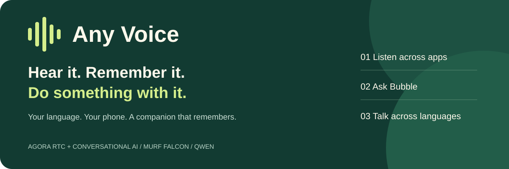
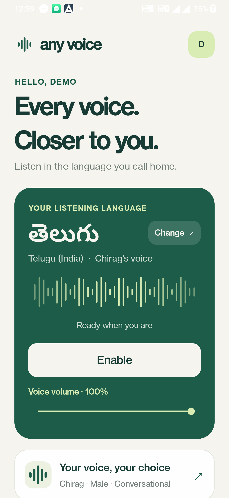
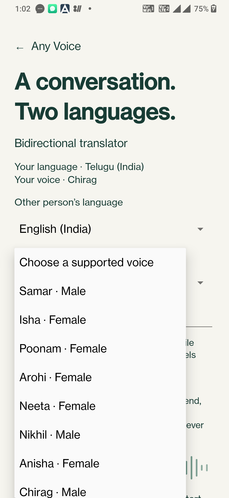
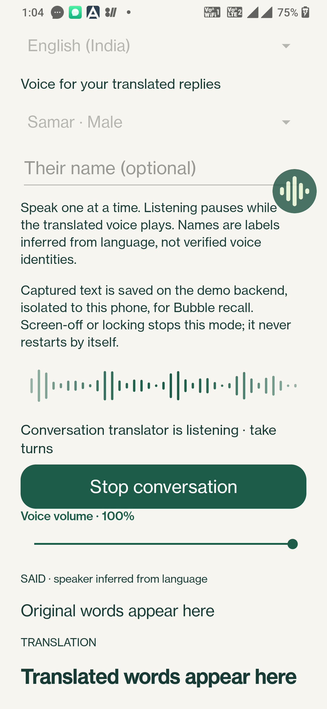
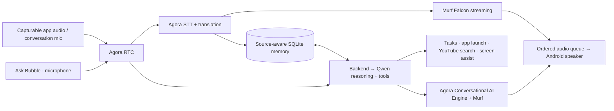

<p align="center"></p>

<p align="center"><strong>Your language. Your phone. A companion that remembers.</strong><br>Built for Build with Agora · Bengaluru · KNOTiC</p>

<p align="center"><a href="https://github.com/Niteesh57/Any_Voice/releases/download/v0.20/AnyVoice-0.20.apk"><strong>↓ Download Android APK · v0.20</strong></a> · <a href="#a-demo-worth-showing">Demo walkthrough</a> · <a href="docs/verification-0.20.md">Verification record</a></p>

You find a great cooking video. The recipe looks perfect. The person explaining it speaks a language you don’t understand.

**Any Voice helps you hear it in your language—and keeps the explanation available when you need it again.** Pause the video, ask Bubble what came after the first step, and get an answer grounded in the instructions the app captured. Save a task, search for another tutorial, or bring the same translation experience into a conversation with someone beside you.

Three useful experiences, connected by one voice companion. No extra gadget to carry.

## One app, three ways to understand

| Experience | What you can do |
|---|---|
| **Listen across apps** | Translate capturable video and social audio into your selected language. Choose a compatible Murf voice, preview it, and control its volume. Confirmed speech already in your language can play in its original voice. |
| **Ask Bubble** | Ask about captured content, remember preferences, create and finish tasks, open apps, or search YouTube. With Screen assist enabled, Bubble can read the current screen, scroll a bounded distance, compare visible choices and ask you when something is unclear. |
| **Talk across languages** | Start a face-to-face conversation translator. Your language comes from your profile; choose the other person’s language and voice. Take turns speaking, hear translations in both directions, and revisit the conversation later. |

The difference is the connection between them. A translation can become context for a question. A question can become a saved task. An answer can lead to an action on your phone.

<p align="center">



</p>
<p align="center"><sub>Actual screens from the OnePlus 7 demo build.</sub></p>

## A demo worth showing

**“Help me cook something I’ve never made before.”**

1. Ask Bubble: **“Open YouTube and search for an American pasta recipe.”** It opens a search in YouTube, with a browser fallback.
2. Ask it to explain or compare the visible results. Screen assist reads what is available and can scroll; you choose and play the video.
3. Hear the captured explanation in your language. Any Voice saves the original and translated text as media evidence.
4. Pause and ask: **“What did he say I should do after adding the sauce?”** Bubble can use the captured instructions instead of starting the conversation from scratch.
5. Say: **“Add a task to try this recipe tomorrow.”** Later: **“I finished that task.”** The task persists and its status changes.

Now switch to a conversation with a friend. If their advice differs from the video, Bubble can retrieve both sources and explain the difference. It should say *“the video said…”* and *“the conversation said…”*, rather than blending them into one invented memory.

This walkthrough combines implemented features. The verification record separates tested provider/device flows from the full human cooking demo; it does not claim unattended video selection or cooking automation.

## The technology doing the work

| Technology | Its role in Any Voice |
|---|---|
| **Agora RTC** | Carries captured playback and microphone audio through separate tracks in a retained real-time session. |
| **Agora Real-Time Speech-to-Text + translation** | Recognizes source speech and produces translated text for media and two-way conversation. There is no separate translation-model API in this route. |
| **Agora Conversational AI Engine** | Provides Bubble’s speech-agent orchestration with Murf voice output. Bubble’s reasoning and tools run in our backend. |
| **Murf AI Falcon 2.1** | Turns translated text and assistant responses into speech. The fast translation route uses persistent streaming WebSockets and parallel generation, with numbered output kept in playback order. |
| **Qwen Omni** | Interprets spoken questions, reasons over retrieved context and screen evidence, and requests validated tools. Replies follow the selected language. The model is configured on the backend. |
| **Persistent memory + tool calling** | SQLite stores tasks, preferences, conversation turns and attributed translation text. Typed tools retrieve evidence, update tasks and request acknowledged Android actions. |
| **Native Android + Python/FastAPI + Docker** | Playback capture, microphone, floating overlay, AudioTrack and opt-in accessibility connect the experience to the phone; the backend keeps provider credentials off the APK. |

Agora’s [STT documentation](https://docs.agora.io/en/realtime-media/speech-to-text) describes transcription and translation over RTC. Murf’s [WebSocket documentation](https://murf.ai/api/docs/text-to-speech/web-sockets) describes persistent Falcon text/audio streaming. We use both as working parts of the experience. Agora Chat and IoT are not used in this build.



Generated PCM reaches the phone through an authenticated backend audio stream. RTC transports source audio; return audio uses that backend stream. During conversation translation, media/Bubble inputs are suspended while their connections remain available for reuse.

## Memory with a source, not just a transcript

**“Where did I hear that?” should have an answer.** Media and face-to-face conversations have separate source labels, capture sessions, timestamps and paired original/translated text. Bubble can compare agreements and disagreements across them. Language-based speaker names are labels, not biometric identity.

Memory is scoped to a private installation identity and key, so two devices’ records do not overlap. It survives voice-session changes and backend restarts when the data volume is retained. Saved facts and tasks can be reviewed in the app. Raw audio is not stored as persistent memory.

Recall uses bounded recent context and searchable records. It is not unlimited perfect recall, and clearing app data creates a new identity. See [memory and actions](docs/memory-tools.md), [media recall](docs/media-memory.md) and [source attribution](docs/bidirectional-translation.md).

## What we measured

| Evidence | Recorded result | What it establishes |
|---|---|---|
| **v0.20 backend regression checks** | **75 tests passed** | Ordering, identity isolation, persistence, voice compatibility, attribution and failure handling. |
| **Native OnePlus 7 round trip** | Both English → Telugu and Telugu → English completed | Live Agora/Falcon integration and Android playback acknowledgments, using synthetic speech fixtures. |
| **Connection reuse** | Same session across media → interpreter → media → Bubble → media | Mode changes can reuse connections instead of rebuilding the main session. |
| **Controlled warm TTS comparison, v0.9** | **224 ms direct Falcon vs 579 ms Engine median time to first PCM** | Three identical Telugu texts, same host, alternating routes. About 61% lower first-PCM latency in this small comparison—not total translation latency. |
| **Source disagreement check** | Video: two minutes; conversation: three minutes | A live Qwen response distinguished the instructions and attributed both sources. |

The TTS comparison is a historical component benchmark, not a v0.20 latency guarantee. Recognition, translation context, network and queue time can still make complete turns take several seconds. Numbered chunks finish in order; this does not promise lip sync or zero delay.

Read the [v0.20 verification record](docs/verification-0.20.md) and [timing/validation history](VALIDATION.md) for scope, methods and remaining checks. Android build and lint passed. Real two-person room noise, overlapping speech and every language/voice combination still need broader testing.

## Why this matters beyond the demo

Creators and platforms already offer translation in different ways. Any Voice adds a personal layer across **compatible apps**, with one language preference and memory that follows the user’s questions. Translation happens when someone needs it; the experience does not require every creator to prepare every language beforehand.

For Agora and Murf, this creates a plausible recurring-use loop: learning and entertainment bring users into translation; questions bring them into a voice companion; real conversations bring them back outside media. Agora supplies transport, transcription/translation and agent infrastructure. Murf supplies the voice people choose and hear repeatedly.

An illustrative adoption scenario—**1,000 users × 10 minutes a day × 30 days = 300,000 user listening minutes per month**—shows the engagement opportunity. This is not observed adoption, billable provider minutes or a revenue forecast. Provider usage, speech duration, pricing and retention would determine commercial results. The next useful metrics are repeat use, end-to-end delay, task completion, translation quality and cost per completed workflow.

## Try Any Voice

[**Download Any Voice 0.20 APK**](https://github.com/Niteesh57/Any_Voice/releases/download/v0.20/AnyVoice-0.20.apk) · [Release and checksum](https://github.com/Niteesh57/Any_Voice/releases/tag/v0.20)


**Android 10+ · ARM64 demo build · tested on OnePlus 7.** Scan the QR on your phone or use the download link. This is a debug hackathon APK, not a Play Store release. It needs an online configured backend; downloading it alone does not provide a hosted service.

Install, open **Profile → Demo connection**, and enter the backend URL and app access token supplied by the person running the demo. Choose your language and a compatible voice, preview it, then enable Any Voice. Grant playback capture/overlay/microphone access for the features you use; Screen assist requires a separate accessibility grant. Conversation translation starts only when you explicitly enable it and stops on lock.

<details>
<summary><strong>Run the backend and build the APK</strong></summary>

Copy [backend/.env.example](backend/.env.example) to `backend/.env` and configure Agora, Murf and Qwen credentials there. Keep it private. See [backend setup](backend/README.md) for provider settings.

```powershell
docker build -t anyvoice-backend:dev backend
docker run -d --name anyvoice-backend --restart unless-stopped --env-file backend/.env -e BUBBLE_MEMORY_PATH=/data/bubble.sqlite3 -v anyvoice-memory:/data -p 8000:8000 anyvoice-backend:dev
.\gradlew.bat :app:assembleDebug :app:lintDebug -PtargetAbi=arm64-v8a -PanyVoiceBackendUrl=http://YOUR_LAN_IP:8000 --console=plain
```

Use the PC’s reachable LAN address with both devices on the same Wi-Fi. Use HTTPS for an internet-facing deployment. The named volume preserves memory across container recreation.

```powershell
cd backend
.\.venv\Scripts\python.exe -m unittest discover -s tests -q
```

The saved rollback is [verified v0.19](docs/verified-baseline-0.19.md). Match the source, backend and APK when reverting.

</details>

<details>
<summary><strong>What the demo can and cannot access</strong></summary>

Android playback capture works only where the source app permits it. Protected content and telephone/WhatsApp call audio are outside this feature. Auto-detection uses a configured source-language shortlist, not every language at once. Available output choices are the live intersection of Agora translation support and Murf voice compatibility; unsupported voice/language pairs are rejected.

Screen assist reads and scrolls with explicit permission. It does not tap, type, buy, send messages or place calls. YouTube search opens results; the user selects the video. Captured memory covers what the app heard, not an entire unseen video or its automatically identified title. The current backend is a single-active-session hackathon deployment, not a multi-user production service.

</details>
