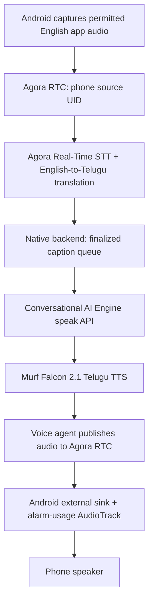

# Any Voice — implemented phase-one architecture

This supersedes the Finch / separate translation-model alternatives in the original research plan.

The source media volume is zero while live translation is connected. The phone never opens a physical microphone audio source. An independent playback stream preserves the prototype's mute-and-replace approach. Speaker behavior still requires real-device testing after provider setup.

The backend is a silent RTC control participant, not an audio translator. It receives Agora caption messages and monitors agent audio for playback pacing. Recognition and translation happen in Agora; speech generation happens in Falcon through Conversational AI Engine. STT subscribes only to the phone source. The voice agent subscribes only to the silent control participant, preventing autonomous replies to video speech and feedback into transcription.

No external LLM or translation-model credentials are used. The agent's required LLM configuration points to our own inert authenticated callback, which emits no content. Actual translation speech comes from explicit `speak` calls. This is genuine engine-controlled output, but it is not yet the optional conversational explanation/glossary workflow described for the hackathon.

The UI is fixed to **English → Telugu** for phase one: start/stop, source/translated captions, backend connection settings, optional floating controls, and the retained local hi audio check. Provider keys are never stored in the APK.

See [backend setup](../backend/README.md), [current validation](../VALIDATION.md), and [hackathon context](HACKATHON.md). Documented provider capabilities and mocked tests are distinct from live authenticated validation; the latter needs supplied credentials and service enablement.
